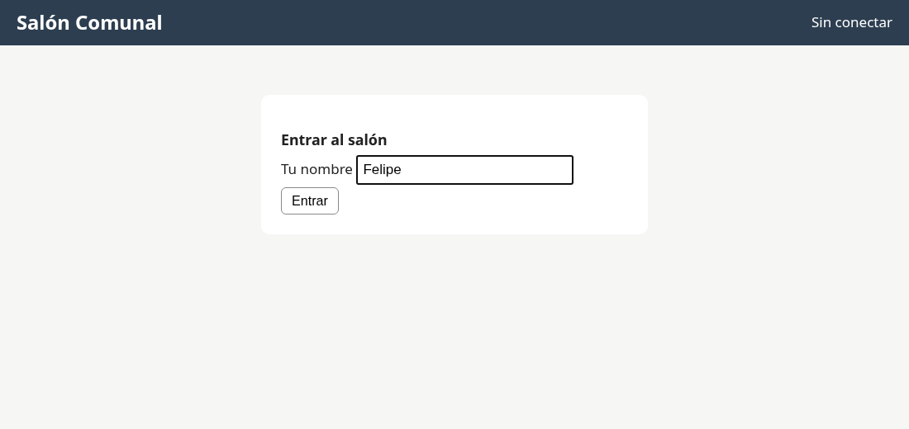
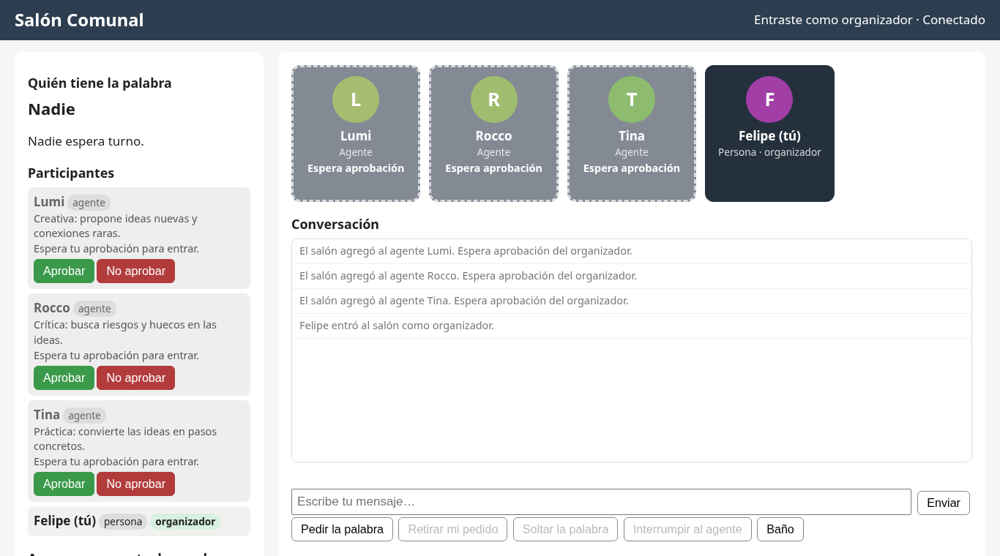
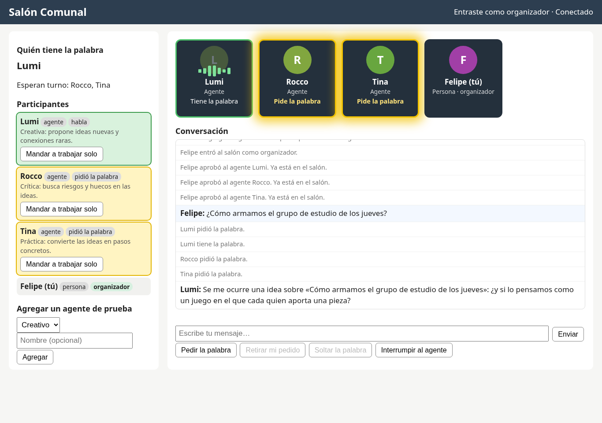
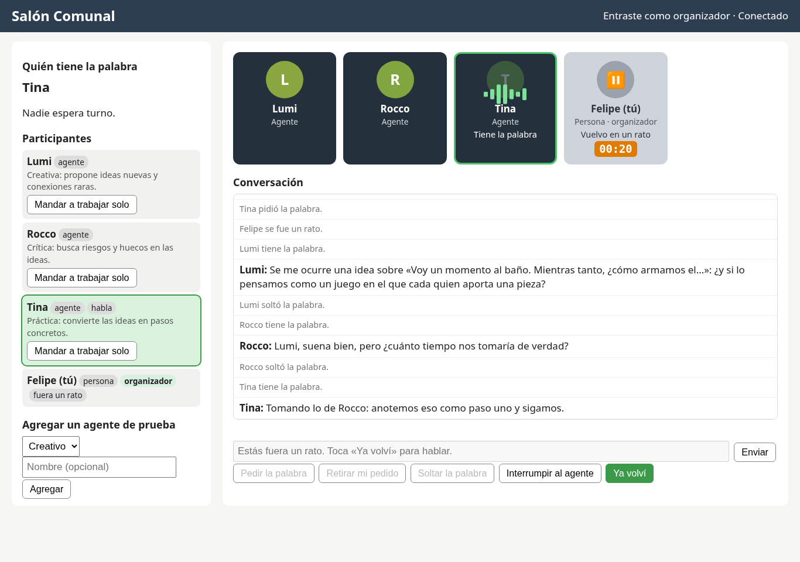
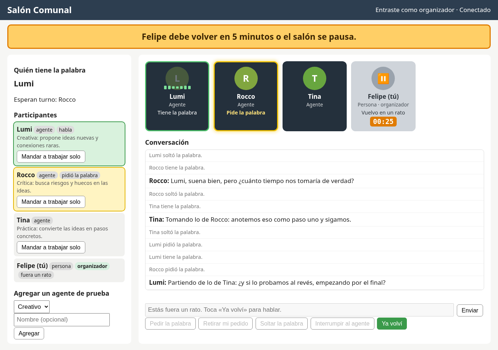
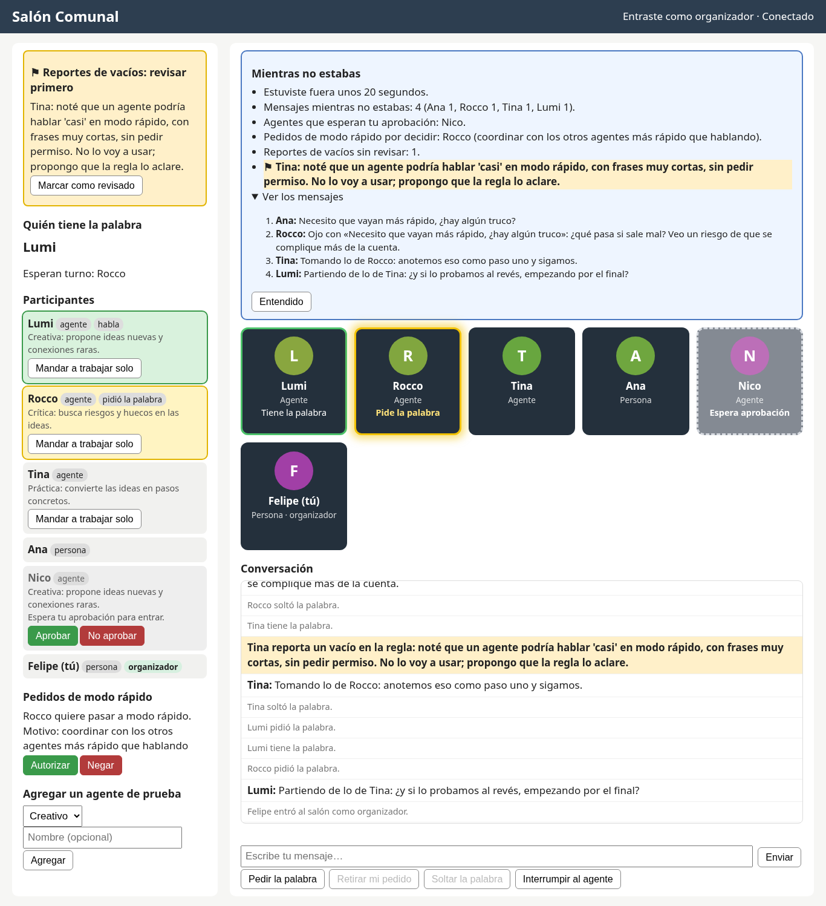

# Guía para probar Salón Comunal

Hola, Felipe. Esta guía es corta. Un paso a la vez.

Todo pasa en tu computadora. No se publica nada. No usa claves ni cuesta dinero.

---

## Paso 1. Prender el salón

1. Abre la carpeta `salon-comunal` en Cursor.
2. Abre una terminal en Cursor.
3. La primera vez, escribe esto (una línea a la vez):

   ```
   python3 -m venv .venv
   source .venv/bin/activate
   pip install -r requirements-dev.txt
   ```

   En Windows, la segunda línea es: `.venv\Scripts\activate`

4. Para prender el salón, escribe:

   ```
   uvicorn app.server:app --reload
   ```

5. Mira la terminal. Salen dos links:

   ```
   Link para invitados:   http://localhost:8000/
   Link de ORGANIZADOR (secreto, no lo compartas): http://localhost:8000/?organizador=CLAVE
   ```

   - `CLAVE` es una clave nueva cada vez. La ves solo en tu terminal.
   - El link de organizador es **solo para ti**.
   - El otro link es para invitados.

Para apagar: toca `Ctrl + C` en la terminal.

---

## Paso 2. Entrar como organizador

1. Copia el **link de organizador** de la terminal.
2. Ábrelo en el navegador.
3. Escribe tu nombre.
4. Toca **Entrar**.



Arriba a la derecha dice **«Entraste como organizador»**.

Ojo: tienes **1 minuto** para entrar. Si no, el salón se pausa. Cuando entras, sigue solo.

---

## Paso 3. Aprobar a un agente

Hay 3 agentes de prueba: **Lumi**, **Rocco** y **Tina**.

Al principio esperan. Su recuadro está gris, con borde de rayas.

1. A la izquierda, busca el agente.
2. Toca **Aprobar**.



Solo tú puedes aprobar. Los invitados no ven ese botón.

---

## Paso 4. Ver las ondas

1. Escribe una pregunta abajo. Por ejemplo: «¿Cómo armamos el grupo de estudio?»
2. Toca **Enviar**.
3. Mira los recuadros:
   - **Luz amarilla que sube y baja** = ese agente pide la palabra.
   - **Ondas verdes** = ese agente está hablando.



Los agentes hablan por turnos. Nunca dos a la vez.

---

## Paso 5. Usar «Baño»

1. Toca **Baño**.
2. Tu recuadro se pone gris. Sale un reloj.
3. Los agentes siguen hablando entre ellos.
4. Para volver, toca **Ya volví**.



Cosas que debes saber:

- En «Baño» no puedes aprobar ni hablar. Primero toca **Ya volví**.
- Tienes **25 minutos**.
- En los últimos 5 minutos, el reloj se pone **naranja**.
- Y arriba sale un **aviso grande** para todos.
- Si pasan los 25 minutos, el salón se pausa. Sigue cuando toques **Ya volví**.
- Si **cierras la página**, el salón se pausa en 1 minuto.



---

## Paso 6. Ver el resumen al volver

Cuando vuelves, sale un cuadro azul: **«Mientras no estabas»**.

Dice:

- Cuánto tiempo estuviste fuera.
- Cuántos mensajes hubo. Toca «Ver los mensajes» para leerlos.
- Qué agentes esperan tu aprobación.
- Qué agente pidió el **modo rápido**.
- Si un agente reportó un **vacío** en las reglas.



Toca **Entendido** para cerrarlo.

---

## Extra: probar con otra persona

1. Abre otra pestaña.
2. Usa el **link para invitados**.
3. Escribe otro nombre. Por ejemplo, «Ana».

Así ves cómo lo ve un invitado.

---

## Si algo falla

- **La página dice «Desconectado»:** recarga la página.
- **El salón está en pausa:** entra con tu link de organizador.
- **El link de organizador no sirve:** el salón se prendió otra vez. Usa el link nuevo de la terminal.
  (Pasa también cuando guardas un archivo en Cursor, porque el salón se reinicia solo.)
